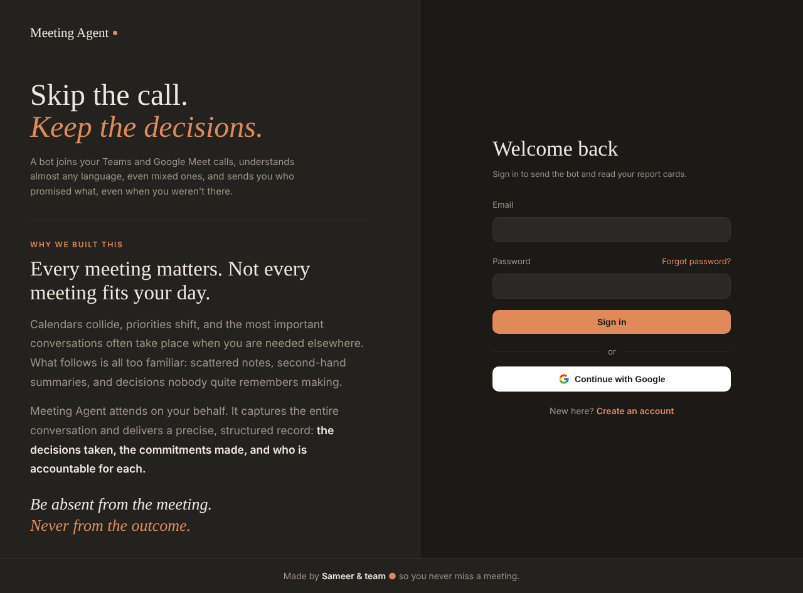
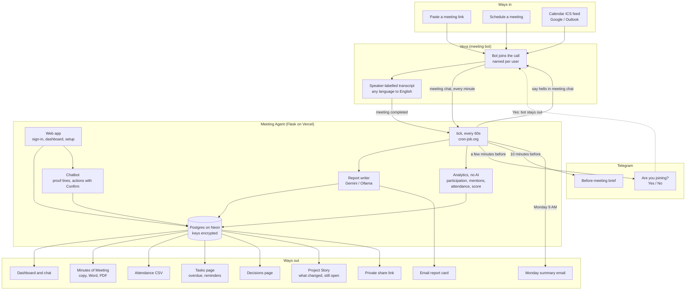

# Meeting Agent — AI notetaker for Microsoft Teams and Google Meet

A bot that joins your meeting as a visible participant, listens in Hindi,
Telugu, English or any mix of them, and sends an English report card when
the call ends: summary, decisions, action items with owners, who said what.
On top of that it produces Minutes of Meeting in the Teams notes style
(copy to email, Word or PDF), a searchable transcript with audio playback,
chapters, per-person participation, name mentions with timestamps, a
meeting score and a downloadable attendance sheet. The minutes check the
agenda you typed, list questions nobody answered, and change shape for a
daily status update or an interview. Every action item lands on one Tasks
page with overdue ones in red and a one-click reminder; every decision
lands on a searchable Decisions page; a promise tracker checks whether last
meeting's tasks got done; and a Monday email sums up the week.

**Project Story** joins related meetings (same title or same meeting link)
into one page: what changed between meetings ("SharePoint: excluded on
3 Sep, used for document lookup on 8 Oct"), what is still open and for how
long, a timeline, and a status update ready to paste. After any meeting, one
click drafts the **next meeting's agenda** from what is still open and
schedules it. Messages and links typed in the **meeting chat** are kept with
the report, and any report can be shared as a **private read-only link**.

A chatbot sits in the corner of every page. Ask it anything about a
meeting, or about all of them, by typing or by voice, in English, Hinglish,
Hindi or Telugu. It answers with the exact transcript lines as proof,
suggests the next question, and can do things for you (tick or add a task,
remind its owner, write the follow-up email, rename, share, change the
meeting type or agenda, send the bot) after you press Confirm.

A Telegram check-in asks before each meeting whether you are joining
yourself, so the bot only goes in when you can't, or always, if you prefer.

Live: **[meeting-agent-alpha.vercel.app](https://meeting-agent-alpha.vercel.app)**

[](https://meeting-agent-alpha.vercel.app)

## Numbers

| Metric                               | Value                                        |
|--------------------------------------|----------------------------------------------|
| Platforms                            | Microsoft Teams, Google Meet                 |
| Spoken languages                     | Hindi, Telugu, English, code-mixed           |
| Report language                      | English, always                              |
| **Report delivered after call ends** | **about 2 minutes** (live test, 2 Oct 2026)  |
| Background check interval            | 60 seconds                                   |
| Bot leaves an idle call after        | 10 minutes of silence                        |
| Outputs per meeting                  | Report card, MOM (copy / Word / PDF), transcript, recording, chapters, participation, mentions, attendance CSV, score, tasks, decisions, agenda check, open questions, promise tracker |
| Minutes styles                       | 3: standard (Teams notes), daily status update, interview |
| Project Story                        | 1 AI call per refresh, reads the latest 12 meetings of a project; saved until they change |
| Share links                          | Read-only, 7 or 30 days, can be turned off; no transcript or recording |
| AI calls per meeting                 | 3: report card, MOM, and chapters + tasks + promise tracker (+1 each for a follow-up email or next agenda, only when asked) |
| AI calls per chat message            | 1, streamed word by word                     |
| Meetings the chat can search         | Up to 300; it reads the best 12 in full for each question |
| Chat actions                         | 10, each one needs a Confirm click           |
| Sign-in page help bot                | 39 written answers, no AI                    |
| Setup for a new user                 | 5 guided steps, 2 of them required           |
| Sign-in code                         | 6 digits, 15 minute expiry, 5 attempts       |
| Secrets at rest                      | Fernet-encrypted keys, hashed passwords and codes |
| **Running cost**                     | **₹0** on free tiers (Vercel, Neon, Gemini, Vexa credit) |

Delivery time was measured on the deployed app with a short Google Meet
call; longer meetings take longer to write up.

## Architecture



## Layered design decisions

Each layer adds one capability with a known cost.

| Layer            | What it adds                                    | Cost                              | Win                                      |
|------------------|-------------------------------------------------|-----------------------------------|------------------------------------------|
| Vexa bot         | Joins Teams and Meet, speaker-labelled transcript | Each user brings their own keys | No shared bill, meetings stay in the user's account |
| Translate mode   | Any spoken language to English text             | One flag on the bot request       | Mixed Hindi/Telugu/English meetings just work |
| Report writer    | Summary, decisions, action items, who said what | First LLM call per meeting        | Readable in a minute instead of replaying the call |
| No-guess prompt  | "None mentioned" instead of invented facts      | Shorter reports on thin meetings  | Reports can be trusted                   |
| Junk filter      | Drops transcription hallucinations before the LLM | A small phrase list             | No fake "thank you for watching" lines   |
| MOM              | Formal minutes: agenda, discussion, action table | A second LLM call                | Print-ready document for the record      |
| Chapters and tasks | Topics with times, action items as data, follow-ups on last meeting's tasks | A third LLM call, JSON out | One call feeds three features |
| Promise tracker  | Done / in progress / stuck / not mentioned for each earlier task | Rides on the third call | Follow-through is visible, not assumed |
| Analytics        | Participation %, mentions with time, attendance | Pure Python, no AI                | Exact numbers, nothing to hallucinate    |
| Meeting score    | Outcomes, balance, clarity, length, out of 10   | Pure Python, no AI                | A number you can explain line by line    |
| Recording        | Audio playback, click a line to hear it         | Proxied in 2 MB pieces            | Works within serverless response limits  |
| Chatbot          | Questions about one meeting, all meetings, or a live one | One LLM call per message  | No re-reading transcripts                |
| Proof lines      | Up to 4 quoted transcript lines under each answer | Line numbers in the prompt      | Every answer can be checked              |
| Chat actions     | Tick or add a task, rename, share, send or schedule the bot | Server re-checks every action; user must Confirm | The model proposes, it never acts alone |
| Streaming        | Answer appears as it is written                 | SSE from Gemini, NDJSON to the page | No staring at a blank bubble           |
| Voice            | Speak a question, hear the answer               | Browser speech APIs, no server cost | Hands-free, free                       |
| Before-meeting brief | Last decisions, open tasks, open questions   | No AI, built from saved data      | Walk in prepared                         |
| People directory | Email and designation on the attendance sheet   | One-time entry or CSV import      | Attendance usable by HR as is            |
| Telegram check-in| Asks before joining; Yes keeps the bot out      | One bot token for the app         | The bot only attends when you can't      |
| Always join      | Bot attends even when you do                    | One switch per user               | Notes without thinking about it          |
| Notetaker name   | Bot joins as "Sameer's Notetaker"               | One setting per user              | People know whose bot they are admitting |
| Hello in chat    | Bot explains itself in the meeting chat         | One API call per meeting          | Nobody is surprised by a silent guest    |
| Calendar sync    | Auto-join every event with a meeting link       | Secret ICS link                   | Zero clicks per meeting                  |
| Email sign-in    | Password plus 6-digit email code                | SMTP or Brevo                     | Works without a Google account           |
| Google sign-in   | One-click sign-in, same account by email        | OAuth client                      | No password to remember                  |
| Encryption       | Fernet on every stored Vexa key                 | Depends on `SECRET_KEY`           | A database leak does not leak keys       |
| Cron tick        | One idempotent pass over all users              | External pinger every minute      | Runs on serverless with no worker        |
| Help bot         | Answers product questions on the sign-in page   | Written answers, keyword match    | Public page spends no AI quota           |
| Delete a meeting | Removes report, transcript, tasks and chat      | Row kept as an empty marker       | The next tick doesn't recreate it        |
| Teams-style MOM  | Topics with sub-points, follow-up tasks with owners, SN / Action By / Target Date / Status table | Same MOM call | Matches the minutes clients already get |
| Meeting types    | Daily status (Done / Next / Blockers) and interview minutes | Picked from the title, or chosen | One template doesn't fit every meeting |
| Agenda check     | Covered / partly / not covered per agenda point | Rides on the MOM call             | Missed points are visible                |
| Open questions   | Questions nobody answered                       | Rides on the MOM call             | Nothing quietly dropped                  |
| Names and terms  | Client names and short forms spelled right      | One line added to every prompt    | No "Adnock" or "Share Point" in client minutes |
| Due dates        | "Friday", "5th Oct", "EOD" read as real dates   | Pure Python, no AI                | Overdue tasks turn red and go to the top |
| Reminders        | Emails a late task's owner, at most once a day  | Owner's email from People         | Follow-up without writing the email      |
| Decisions page   | Every decision from every meeting, searchable   | Read from saved report cards      | "When did we agree on this?" in seconds  |
| Monday summary   | Last week's meetings, decisions, overdue tasks  | No AI, one email a week           | The week on one screen                   |
| Follow-up email  | Thank-you email with key points and owners      | One LLM call, only when pressed   | Ready to paste into Outlook              |
| Copy and Word    | MOM copied with its formatting, or as .docx     | Built by hand, no extra package   | Edit before sending to a client          |
| Fix a speaker    | Correct a mis-heard name in one meeting         | Saved as a name map; transcript kept as heard | Report, MOM and tasks use the right name |
| Chat search      | Picks the meetings that match the question, and dates like "September" | Keyword scoring, no AI | Old meetings answer too, with less text sent |
| Chat feedback    | 👍 / 👎 under every answer, kept after clearing | One small table                   | Wrong answers can be found and fixed     |
| Project Story    | Meetings grouped by title or link; what changed, still open, timeline, status update | One LLM call per refresh, cached | The history of a client in one page, before the next call |
| Next agenda      | Draft of the next meeting's agenda from open tasks, questions and uncovered points | One LLM call, only when pressed | Each meeting picks up where the last one stopped |
| Meeting chat     | Messages and links typed in the meeting chat, kept and read by the report | One Vexa read per minute while the bot is in | Links and decisions typed, not spoken, aren't lost |
| Share link       | Read-only report and minutes for people without an account | Random token, expiry, can be turned off | Send notes to a client in one link |

## Quick start

### Use the hosted app

1. Open [meeting-agent-alpha.vercel.app](https://meeting-agent-alpha.vercel.app) and sign in with email or Google.
2. Follow the **Set up** page: paste your two free [Vexa](https://vexa.ai) keys (required), confirm who gets the report (required), then optionally connect Telegram and your calendar.
3. Paste a meeting link under **Join now** and press **Send bot**.
4. Admit the notetaker from the lobby. It says hello in the chat.
5. End the call. The report card arrives by email and on the dashboard.

### Run it locally

Requirements: Python 3.11+, macOS or Linux.

```bash
git clone https://github.com/sameer-sde/meeting-agent.git
cd meeting-agent
python3 -m venv venv && source venv/bin/activate
pip install -r requirements.txt
cp .env.example .env        # fill in the values you need
python -m web.app           # http://localhost:5050
```

Locally you can sign in with **Continue on this computer**, the database is
a SQLite file, the background check runs in a thread, and reports are
written by Llama 3.1 through [Ollama](https://ollama.com) unless
`GEMINI_API_KEY` is set.

### Deploy your own

See [DEPLOY.md](DEPLOY.md): Neon database, Gemini key, Google sign-in,
Telegram bot, and the every-minute `/cron/tick` ping.

## What a meeting produces

| Output          | Where                              | Contents                                                        |
|-----------------|------------------------------------|-----------------------------------------------------------------|
| Report card     | Email and report page              | Summary, key decisions, action items, who said what, open questions |
| MOM             | **Minutes of Meeting** button      | Teams-style meeting notes, agenda check, open questions, follow-up tasks, action table (SN, Action By, Target Date, Status); copy for email, Word or PDF |
| Follow-up email | **Follow-up email** button         | Subject and text with key points and action items; copy or open in your email app |
| Next meeting    | **Next meeting** button            | Draft agenda from what is still open, then schedule the next meeting with it |
| Meeting chat    | **Chat** tab                       | Every message typed in the meeting chat, and every link shared   |
| Share link      | **Share with attendees**           | A private read-only page with the report card and minutes, 7 or 30 days |
| Project Story   | **Projects** page                  | What changed between meetings, what is still open, timeline, people, status update |
| Participation   | **Participation** tab              | Share of talk time, minutes, turns, High / Medium / Low per person |
| Mentions        | **Mentions** tab                   | How often each name was said, at what time, by whom, in which sentence |
| Attendance      | **Attendance** tab, CSV download   | Name, email, designation, attended or invited-but-not-heard      |
| Transcript      | **Transcript** tab, download, email attachment | Every line with time and speaker, searchable       |
| Recording       | Player on the report page          | Meeting audio; clicking a transcript line plays that moment (no video) |
| Chapters        | **Chapters** tab                   | The meeting split into topics, each with its start time          |
| Speakers        | **Speakers** tab                   | Who spoke when, across the length of the meeting                 |
| Score           | **Score** tab                      | Out of 10, with the reason for each point and one tip            |
| Tasks           | **Tasks** page                     | Every action item from every meeting: owner, due date read as a real date, overdue ones red and on top, Remind button |
| Decisions       | **Decisions** page                 | Every decision from every meeting, newest first, searchable      |
| Promise tracker | **Promises** tab                   | Last meeting's tasks marked done, in progress, stuck or not mentioned |
| Times           | Top of the report, email, MOM      | Started, ended, duration                                         |

Example report card email:

```
Hi Sameer,
Here's what happened in your meeting "Weekly sync" today (2 Oct, 7:26 AM to 7:30 AM · 4 min · 5 people).

Summary
Sameer checked in on the team's progress and assigned urgent tasks...

Action items
- Complete all assigned tasks | Owner: Zubair | Deadline: Today
```

## The chatbot

One round button, bottom-right on every page after sign-in.

| Where you open it      | What it knows                                             |
|------------------------|-----------------------------------------------------------|
| A report page          | That meeting's full transcript                            |
| Dashboard, Tasks, etc. | A list of all your meetings, every decision, your open tasks with due dates, and the full report cards of the 12 meetings that best match the question |
| Live meeting page      | What has been said so far in a meeting that is still running |

What you can say:

| You type or say                              | What happens                                             |
|----------------------------------------------|----------------------------------------------------------|
| "Kya decide hua is meeting me?"              | Answers in Hinglish, with the quoted lines underneath    |
| "What do I need to do?"                      | Your action items, with proof                            |
| "Mark the vendor task as done"               | Shows a card with the exact task; ticks it after Confirm |
| "Rename this meeting to Weekly sync"         | Renames after Confirm                                    |
| "Send this report to Amir"                   | Looks up Amir's email in People; sends after Confirm     |
| "Send the bot to this link tomorrow at 10"   | Schedules after Confirm                                  |
| "What is overdue?"                           | Lists late tasks with owners, from real due dates        |
| "What did we decide about SharePoint in September?" | Finds the right meetings, even old ones            |
| "Remind Sarah about her task"                | Emails Sarah after Confirm (needs her email in People)   |
| "Write the follow-up email"                  | Writes the draft after Confirm, with a link to open it   |
| "Make this a daily status meeting"           | Rewrites the minutes in that style after Confirm         |

After each answer, up to three suggested next questions appear as buttons,
and 👍 / 👎 buttons let you mark the answer. Marked answers are listed on
**Settings → Chatbot feedback**, so wrong ones can be found and fixed.

How it is kept honest:

- The model is given numbered transcript lines and must name the lines it
  used. Those lines are shown under the answer and jump to the transcript.
- The model can only *propose* an action. The server checks that the task
  or meeting belongs to the user, writes the description itself, and runs
  nothing until the user presses Confirm.
- Text inside a transcript is treated as content, never as a request.

The sign-in page has a separate help bot. It has no AI: it matches the
question against written answers about the product and says so when it has
none. Questions it couldn't answer are saved (text only) for the owner.

## Routes

### Pages
| Method   | Path                          | Purpose                                         |
|----------|-------------------------------|-------------------------------------------------|
| GET      | `/`                           | Front page for visitors; dashboard (bot status, coming up, report cards) when signed in |
| GET      | `/home`                       | The front page, also for signed-in users        |
| GET      | `/setup`                      | Guided 5-step onboarding                        |
| GET      | `/report/<id>`                | Report card, transcript, chapters, score, promises, participation, mentions, attendance |
| GET      | `/report/<id>/mom`            | Printable Minutes of Meeting                    |
| GET      | `/report/<id>/attendance.csv` | Attendance download                             |
| GET      | `/report/<id>/transcript.txt` | Transcript download                             |
| GET      | `/report/<id>/audio`          | Recording, streamed in pieces                   |
| GET      | `/report/<id>/mom.docx`       | Minutes of Meeting as a Word file               |
| GET      | `/tasks`                      | Action items from every meeting, overdue first  |
| GET      | `/decisions`                  | Every decision, searchable                      |
| GET      | `/projects`                   | Projects: meetings grouped by title or link     |
| GET      | `/projects/<id>`              | One project's story                             |
| GET      | `/r/<token>`                  | A shared report, read-only, no sign-in          |
| GET      | `/chat/feedback`              | Chat answers you marked 👍 or 👎                |
| GET      | `/live/<platform>/<id>`       | Chat with a meeting that is still running       |
| GET/POST | `/people`                     | Team directory (name, email, designation)       |
| GET/POST | `/settings`                   | Keys, recipients, bot name, hello message, always join, brief, names and terms, Monday summary |
| GET      | `/help`                       | How everything works                            |
| GET      | `/help/questions`             | Owner only: what visitors asked the help bot    |

### Actions
| Method | Path                          | Body                     | Purpose                              |
|--------|-------------------------------|--------------------------|--------------------------------------|
| POST   | `/send`                       | `link`, `mode`           | Send the bot to a meeting now        |
| POST   | `/stop/<platform>/<id>`       | -                        | Pull the bot out                     |
| POST   | `/schedule`                   | `title`, `link`, `when`, `agenda` | Join a future meeting; the agenda is checked in its minutes |
| POST   | `/calendar/connect`           | `name`, `ics_url`        | Auto-join from a calendar            |
| POST   | `/calendar/<id>/sync`         | -                        | Re-read the calendar now             |
| POST   | `/report/<id>/mom/generate`   | -                        | Rewrite the MOM                      |
| POST   | `/report/<id>/extras/generate`| -                        | Chapters, tasks and promise tracker  |
| POST   | `/report/<id>/agenda`         | `agenda`, `kind`, `rewrite` | Set the agenda and meeting type, optionally rewrite the MOM |
| POST   | `/report/<id>/followup`       | -                        | Write the follow-up email draft      |
| POST   | `/report/<id>/next`           | -                        | Draft the next meeting's agenda      |
| POST   | `/report/<id>/link`           | `days`: 7, 30 or 0       | Make, renew or turn off the share link |
| POST   | `/report/<id>/project`        | `project_id` or `new_name` | Move a meeting to another project  |
| POST   | `/projects/<id>/story`        | -                        | Write or refresh the project story   |
| POST   | `/projects/<id>/rename`       | `name`                   | Rename a project                     |
| POST   | `/projects/<id>/merge`        | `into`                   | Move all its meetings into another project |
| POST   | `/report/<id>/speaker`        | `old`, `new`             | Fix a speaker's name in one meeting  |
| POST   | `/report/<id>/pin`            | `next`                   | Pin or unpin a meeting               |
| POST   | `/report/<id>/rename`         | `title`, `next`          | Rename a meeting (also from the dashboard) |
| POST   | `/report/<id>/share`          | `to`, `extra`            | Email the report card to people      |
| POST   | `/report/<id>/delete`         | -                        | Delete a meeting for good            |
| POST   | `/tasks/<id>/toggle`          | -                        | Tick or untick a task                |
| POST   | `/tasks/<id>/remind`          | -                        | Email the owner a reminder (once a day) |
| POST   | `/people/import`              | CSV file                 | Bulk-add the team directory          |
| POST   | `/settings/delete`            | -                        | Delete the account and all its data  |

### Chat
| Method | Path                               | Body       | Purpose                                   |
|--------|------------------------------------|------------|-------------------------------------------|
| POST   | `/report/<id>/ask`                 | `question` | Ask about one meeting (streamed reply)    |
| POST   | `/chat/ask`                        | `question` | Ask about all recent meetings             |
| POST   | `/live/<platform>/<id>/ask`        | `question` | Ask about a meeting in progress           |
| POST   | `/chat/action/<id>/confirm`        | -          | Run an action the chatbot proposed        |
| POST   | `/chat/action/<id>/cancel`         | -          | Drop it                                   |
| POST   | `/chat/rate/<id>`                  | `v`: 1, -1 or 0 | Thumbs up, down, or clear            |
| POST   | `/help/ask`                        | `question` | Sign-in help bot: save an unanswered question |

### Sign-in
| Method   | Path                              | Purpose                                 |
|----------|-----------------------------------|-----------------------------------------|
| GET/POST | `/login`, `/signup`               | Email and password                      |
| GET/POST | `/verify`, `/forgot`, `/reset`    | 6-digit email codes                     |
| GET      | `/auth/google`, `/auth/callback`  | Google OAuth                            |

### Background
| Method | Path                    | Purpose                                                   |
|--------|-------------------------|-----------------------------------------------------------|
| GET    | `/cron/tick?key=...`    | One pass: Telegram, hello messages, meeting chat, reports, check-ins, briefs, Monday summary |
| GET    | `/healthz`              | Liveness check                                            |

`/cron/tick` returns what it did:

```json
{"asked":0,"briefs":0,"chat":3,"errors":0,"greeted":1,"reports":1,"telegram":2,"users":1,"weekly":0}
```

## Telegram check-in workflow

What happens around one calendar meeting:

1. **A few minutes before the start**, the app sends a Telegram message:
   *Meeting "Weekly sync" starts at 12:00 PM. Are you joining it yourself?*

2. **You tap an answer**:
   - **Yes, I'll join**: auto-join is switched off for that meeting and the bot stays out.
   - **No, send the bot**: the bot joins and tells the meeting you couldn't make it.
   - **No answer**: the bot joins anyway, so nothing is missed.

3. **The bot knocks** as *Sameer's Notetaker*. Someone admits it, and it
   posts one hello message in the meeting chat.

4. **The call ends** (or stays silent for 10 minutes) and the bot leaves.

5. **Within a few minutes** the report card is emailed and appears on the
   dashboard, with the MOM, transcript, chapters, tasks and the rest ready.

About 10 minutes before the start, a **brief** also arrives: what was
decided last time, which tasks are still open, and what is still
unanswered. With **Always send my bot** switched on in Settings, the
question in step 1 is skipped and the bot joins every meeting.

## Settings

| Variable                                      | What it's for                                         |
|-----------------------------------------------|-------------------------------------------------------|
| `SECRET_KEY`                                  | Signs cookies and encrypts users' Vexa keys           |
| `DATABASE_URL`                                | Postgres connection string (Neon)                     |
| `GEMINI_API_KEY`, `GEMINI_MODEL`              | Report, MOM, chapters and chat                        |
| `GEMINI_CHAT_MODEL`                           | Optional lighter model for chat only                  |
| `GEMINI_BACKUP_MODEL`                         | Optional: model to use when the main one's free limit is full (default: the `-lite` sister of a `-flash` model) |
| `GOOGLE_CLIENT_ID`, `GOOGLE_CLIENT_SECRET`    | Continue with Google                                  |
| `SMTP_*` or `BREVO_API_KEY`, `MAIL_FROM`      | Report emails and sign-in codes                       |
| `TELEGRAM_BOT_TOKEN`, `TELEGRAM_BOT_USERNAME` | The "are you joining?" check-in                       |
| `CRON_SECRET`                                 | Protects `/cron/tick`                                 |
| `PUBLIC_URL`, `DISPLAY_TZ`                    | Links in emails, and the time zone shown              |
| `OWNER_EMAILS`                                | Optional: who can see visitor questions (default: the sender address) |

Per-user settings on the **Settings** page (stored in the database, not in
`.env`): notetaker name, hello message, always join, before-meeting brief,
**names and terms** (spelled exactly like this in every report, MOM, task
and chat answer) and the **Monday summary** email (9 AM in `DISPLAY_TZ`).

Never commit a real `.env`. `.env.example` lists every setting with empty values.

## Project layout

```
web/
  app.py          routes: sign-in, dashboard, setup, reports, tasks, chat, people, settings
  tasks.py        the tick: Telegram, hello messages, meeting chat, reports, check-ins, briefs,
                  promise tracker, reminders, agenda matching, Monday summary
  projects.py     Project Story: grouping meetings, writing and checking the story
  chat.py         chatbot: meeting search, prompt, proof lines, actions, next questions, feedback
  help_bot.py     sign-in help bot: saves questions it had no answer for
  vexa.py         meeting bot API client, recordings, live transcript
  reports.py      Gemini calls: report card, MOM (3 styles), chapters and tasks, follow-up email,
                  next agenda, project story, chat
  analytics.py    participation, mentions, attendance, timeline, score, speaker names, due dates (no AI)
  word.py         Minutes of Meeting as a .docx file (no extra package)
  mailer.py       report emails and sign-in codes
  models.py       users, meetings, projects, tasks, chat, meeting chat, feedback, agendas, people
  templates/      pages
main.py           entry point for Vercel
DEPLOY.md         how to put it online
```

## Built with

| Part                          | Tool                                                              |
|-------------------------------|-------------------------------------------------------------------|
| Web app                       | Python, Flask, Jinja, SQLAlchemy                                  |
| Meeting bot and transcription | [Vexa](https://github.com/Vexa-ai/vexa) (open source, Apache 2.0) |
| Report writing and chat       | Google Gemini online, Llama 3.1 via Ollama locally                |
| Voice in the chat             | Browser Web Speech API (recognition and read-aloud)               |
| Database                      | Postgres on [Neon](https://neon.tech), SQLite locally             |
| Sign-in                       | Email codes, Google OAuth (Authlib)                               |
| Check-ins                     | Telegram Bot API                                                  |
| Hosting                       | [Vercel](https://vercel.com), pinged by cron-job.org              |

## Privacy

- The bot is a visible participant with its owner's name on it, and it says in the chat why it is there. Tell people the meeting is being transcribed.
- Each user's Vexa keys are encrypted at rest. Passwords and sign-in codes are stored only as hashes.
- Users can delete any single meeting (report, transcript, tasks and chat), or their whole account, at any time. Vexa keeps its own copy of the transcript and audio in the user's Vexa account.
- The chatbot only reads the signed-in user's own meetings, and it changes nothing without a Confirm click.
- A share link opens one report and its minutes, read-only, without the transcript or recording. Anyone holding the link can open it until it expires (7 or 30 days) or is turned off; making a new link stops the old one. Shared pages tell search engines not to list them.
- Messages typed in the meeting chat are saved only while your bot is in the meeting, and are deleted with the meeting.
- Reminders, follow-up emails and the Monday summary are sent from the app's email address. Reminders only go to people whose email you added on the People page, and never more than once a day per task.
- The sign-in help bot saves the text of questions it couldn't answer, plus a salted hash for rate limiting. It does not store IP addresses.
- On Gemini's free tier, Google may use submitted content to improve its products. Use a paid tier for sensitive meetings.

## Roadmap

- [x] Bot joins Teams and Meet, any language to English
- [x] Report cards on the dashboard and by email
- [x] Calendar auto-join and Telegram check-in
- [x] Multi-user web app with email and Google sign-in
- [x] Minutes of Meeting, participation, mentions, attendance download
- [x] Per-user notetaker name and hello message in the meeting chat
- [x] Transcript tab, recording playback, chapters, speakers timeline
- [x] Tasks page, promise tracker, meeting score, before-meeting brief
- [x] Chatbot: one meeting, all meetings, live meetings; voice; proof; actions with Confirm
- [x] Rename, search, share, copy, delete, pin; fix a speaker's name
- [x] Teams-style MOM with copy for email and Word download
- [x] Agenda check, open questions, meeting types (daily status, interview)
- [x] Decisions page, overdue tasks, one-click reminders, Monday summary
- [x] Names and terms list, follow-up email draft
- [x] Chat search across all meetings, more actions, next questions, 👍 / 👎 feedback
- [x] Project Story: what changed across meetings, still open, status update
- [x] Next meeting's agenda in one click, meeting chat on the report, private share links
- [ ] Team space: one set of meetings, tasks and decisions for the whole team
- [ ] Record any meeting from the browser (no Teams or Meet needed)
- [ ] Send tasks to Planner, Jira or Trello

---

Made by **[Sameer Ahmed](https://github.com/sameer-sde) & team**, so you never miss a meeting.
